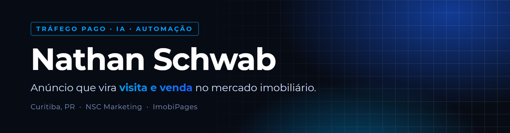

### Oi, eu sou o Nathan

Gestor de tráfego pago em Curitiba e fundador da **NSC Marketing**. Fui corretor de imóveis antes de virar agência, então sei o que acontece depois que o lead chega. Hoje junto as duas coisas: anúncio no Meta e no Google para corretor e imobiliária, e ferramenta própria feita com IA para tirar o trabalho repetido da frente.

---

### Projetos que eu criei

| Projeto | O que faz | Feito com |
|---|---|---|
| **ImobiPages** | SaaS para corretor: página do imóvel por blocos, formulário que classifica o lead em quente, morno ou frio, CRM em kanban e painel de conversão por página. Em desenvolvimento. | TypeScript, React, Node, Prisma, Supabase |
| **Escritório NSC** | Time de 35 agentes de IA com função, memória e rotina própria (estratégia, tráfego, copy, comercial, tecnologia). Conversam num grupo ao vivo, entregam rascunho para aprovação e aparecem num escritório em pixel art dentro do VS Code. | Python, Claude Code, extensão de VS Code |
| **Revisão diária de Google Ads** | Todo dia às 9h30 lê a carteira inteira pela API e manda no WhatsApp um PDF e uma versão interativa: status de cada conta, conversão por canal, leilão, efeito das mudanças dos últimos 30 dias, termos de busca para negativar e site fora do ar. Sem LLM, roda sozinha. | Python, Google Ads API, Baileys |
| **Monitor de sites 24h** | A cada 10 minutos testa a página final dos anúncios ativos e avisa só quando um site cai ou volta. | Python |
| **Automação de DM no Instagram** | A pessoa comenta uma palavra no post e recebe a mensagem no direct, com resposta pública no comentário. | Cloudflare Workers, Instagram Graph API |
| **Central do Google** | Pesquisa de palavra-chave pelo Planejador com filtro explicado (o que saiu e por quê) e anúncio responsivo validado antes de subir. | Python, Google Ads API |
| **Fábrica de conteúdo** | Geradores dos formatos do meu Instagram: post de frase, card de notícia, capa de carrossel, stories, Reels editado a partir do vídeo bruto e vídeo narrado por IA a partir de um roteiro. | Python, Playwright, HyperFrames, TTS |

### Projetos que eu gerenciei

- **Google Ads para clínicas odontológicas**: carteira de contas em Pesquisa e Performance Max, com revisão diária, negativação e otimização semanal.
- **Meta Ads e Google Ads em agência**: contas de serviço, varejo e mercado imobiliário.
- **Minhas campanhas como corretor**: tráfego pago na própria carteira de imóveis, com o Método das Duas Camadas (interesse com filtro de poder de compra por cima).
- **Roteiros de vídeo**: roteiros para campanhas imobiliárias e de saúde.

---

### Ferramentas do dia a dia

Os repositórios são privados porque guardam dado de conta de anúncio. Se quiser ver algum funcionando, me chama no Instagram.
